 

---

##  About Me

I'm a **BS Artificial Intelligence** student at **FAST NUCES**, building intelligent, autonomous systems and high-throughput architectures. I focus on developing **Agentic AI workflows**, **persistent cognitive memory systems**, and **accelerated parallel computing** pipelines.

-  **Focus:** Agentic AI architectures, LLM orchestration, persistent memory pipelines, high-performance computing
-  **Exploring:** Multi-agent swarms, distributed tokenization, RAG optimization, CUDA / PDC
-  **Always tinkering with:** Autonomous workflow automation, system design, parallel algorithms
-  **Main languages & tech:** Python, C++, CUDA / PDC, PyTorch

---

##  Tech Stack

| | |
|---|---|
| **Languages** | Python · C++ · C# · JavaScript · SQL · CUDA / C |
| **Agentic AI & ML** | LLM Orchestration · Persistent Memory Systems · PyTorch · RAG · LangChain / Custom Agents · NLP |
| **High Performance** | Parallel Distributed Computing (PDC) · GPU Acceleration · Multi-threading · Optimization |
| **Tools & Platforms** | Git · Docker · FastAPI · VS Code · Jupyter / Colab · Linux / Windows |

---

##  Featured Projects

<table>
  <tr>
    <td width="50%" valign="top">
      <h3> <a href="https://github.com/yuvi-zen/Liftpilot">LiftPilot</a></h3>
      

        
        
        
      

      
Autonomous gym-progression agent featuring persistent multi-tiered memory, safety guardrails, and automated planning.

    </td>
    <td width="50%" valign="top">
      <h3> <a href="https://github.com/yuvi-zen/Hybrid-RAG-Agent">Hybrid RAG Agent</a></h3>
      

        
        
        
      

      
Voice-enabled conversational shopping assistant modeled after Daraz, combining vector search with keyword retrieval.

    </td>
  </tr>
  <tr>
    <td width="50%" valign="top">
      <h3> <a href="https://github.com/yuvi-zen/Gpu-Bpe-Tokenizer-Using-PDC">GPU BPE Tokenizer</a></h3>
      

        
        
        
      

      
High-throughput Byte-Pair Encoding tokenization leveraging parallel and distributed computing for large language datasets.

    </td>
    <td width="50%" valign="top">
      <h3> <a href="https://github.com/yuvi-zen/PakARAB-">PakArab AI</a></h3>
      

        
        
        
      

      
Industrial chatbot and workflow assistant engineered for PakArab Fertilizers LTD operational query resolution.

    </td>
  </tr>
  <tr>
    <td width="50%" valign="top">
      <h3> <a href="https://github.com/yuvi-zen/Urdu-Stories-Generation-Model">Urdu Story Generator</a></h3>
      

        
        
        
      

      
Generative natural language processing model specialized for Urdu fiction, narrative structuring, and story generation.

    </td>
    <td width="50%" valign="top">
      <h3> <a href="https://github.com/yuvi-zen/RideFlow">RideFlow</a></h3>
      

        
        
        
      

      
Dynamic ride dispatch and urban mobility platform optimizing real-time driver allocation and trip routing.

    </td>
  </tr>
</table>

<b>More projects & experiments</b>

 

-  [**LiftPilot Agent**](https://github.com/yuvi-zen/Liftpilot) — Gym progression agent with long-term memory
-  [**Hybrid-RAG-Agent**](https://github.com/yuvi-zen/Hybrid-RAG-Agent) — Conversational shopping agent with hybrid search
-  [**Gpu-Bpe-Tokenizer-Using-PDC**](https://github.com/yuvi-zen/Gpu-Bpe-Tokenizer-Using-PDC) — Parallel BPE tokenization
-  [**PakARAB-**](https://github.com/yuvi-zen/PakARAB-) — Chatbot for PakArab Fertilizers LTD
-  [**Urdu-Stories-Generation-Model**](https://github.com/yuvi-zen/Urdu-Stories-Generation-Model) — Narrative text generation
-  [**RideFlow**](https://github.com/yuvi-zen/RideFlow) — Intelligent mobility routing platform

---

##  GitHub Stats

  

  

---

##  Let's Connect

I'm always open to discussing Agentic AI, high-performance computing, distributed systems, or collaborative projects. Reach out anywhere below.

 

